## Specifications {#specs data-jp="2"}

| | |
|---|---|
| Product name | Lucky CP32 paper processor |
| Transport method | Opposite direction transport |
| Compatible paper | RC paper; fiber-based paper cannot be processed |
| Processing size | Hand size (83 × 108 mm) to small half cut, 12 × 16 inches (305 × 406 mm) |
| Processing | Negative–positive color, positive–positive color (P-30), and monochrome prints |
| Transport speed | 42–420 mm/min, shown on the digital display |
| Processing time | 30 seconds to 5 minutes per tank |
| Processing tanks | 3, single deck |
| Tank capacity | 2 liters each |
| Temperature control | Constant temperature by microcomputer for each tank, 20–40 °C, accurate to ±0.1 °C; set for each tank in steps of 0.1 °C; shown on the digital display |
| Agitation | Circulation by magnet pump |
| Paper detection | Infrared sensor at the entrance of tank 1 |
| Standby | After 45 minutes without use, the roller drive stops, then runs for 3 seconds every 15 seconds. Inserting paper cancels standby. |
| Ventilation | Humidity exhaust and ventilation fan |
| Dry-run protection | Protects the unit when the solution runs out |
| Drain | Through each tank’s drain hose |
| Power | AC 100 V, 50/60 Hz, 350 W |
| Display | Single control panel; backlit liquid crystal display that adjusts its brightness to the room |
| Dimensions | 600 (W) × 610 (D) × 250 (H) mm |
| Dry weight | 29.0 kg |
| Accessories | 5 A fuse 1, funnels 2, drain hoses 3, overflow hoses 4, spanner 1 |
| Options | Automatic replenishment unit, WD module |

## Parts {#parts data-jp="3" data-break="page"}

The parts diagram from the Japanese manual. Its labels, in English:

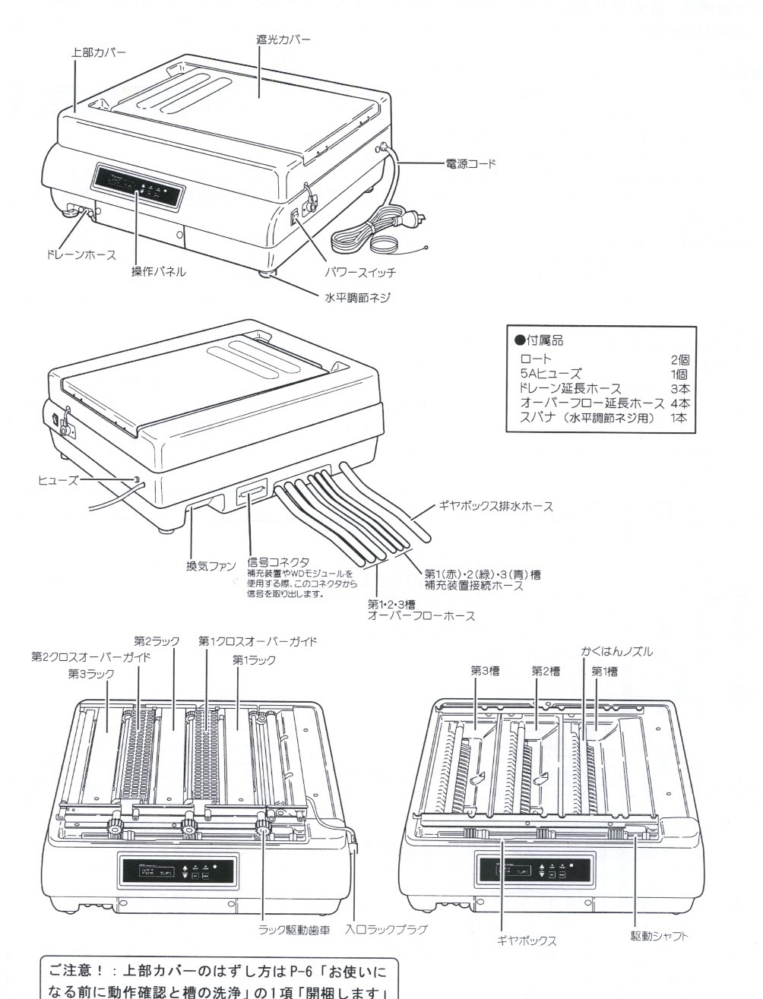

| Label | Part |
|---|---|
| 上部カバー | Top cover |
| 遮光カバー | Light-shielding cover |
| 電源コード | Power cord |
| 操作パネル | Operating panel |
| パワースイッチ | Power switch |
| 水平調節ネジ | Leveling screw |
| ドレーンホース | Drain hose |
| ヒューズ | Fuse |
| 換気ファン | Ventilation fan |
| 信号コネクタ | Signal connector, for a replenisher or the WD module |
| 第1(赤)・2(緑)・3(青)槽 補充装置接続ホース | Replenisher hoses for tanks 1 (red), 2 (green), and 3 (blue) |
| ギヤボックス排水ホース | Gearbox drain hose |
| 第1・2・3槽 オーバーフローホース | Overflow hoses for tanks 1–3 |
| 第1ラック, 第2ラック, 第3ラック | Racks 1, 2, and 3 |
| 第1クロスオーバーガイド, 第2クロスオーバーガイド | Crossover guides 1 and 2 |
| ラック駆動歯車 | Rack drive gear |
| 入口ラックプラグ | Inlet rack plug |
| 第1槽, 第2槽, 第3槽 | Tanks 1, 2, and 3 |
| かくはんノズル | Agitation nozzle |
| ギヤボックス | Gearbox |
| 駆動シャフト | Drive shaft |
| 付属品 | Accessories: funnels (2), 5 A fuse (1), drain extension hoses (3), overflow extension hoses (4), and a spanner for the leveling screws (1) |

To remove the top cover, see step 1 of [Before Use](#before-use).

## Installation {#installation data-jp="4"}

- The CP32 paper processor, and the optional WD module, need the space shown below.
- Place the unit about 30 cm to the right of the enlarger. This makes the light-shielding cover easier to open.
- Use the CP32 on a table, not on the floor: it drains by gravity.
- Install it level on a sturdy stand, so that it does not tilt.
- Do not shake the unit after filling it. Even a little solution from tank 2 or 3 in tank 1 spoils the color.
- If the drain hoses or overflow hoses are too short, connect the supplied extension hoses.
- Place three containers of about 2 liters on the floor, and put each overflow hose of the unit in its own container.

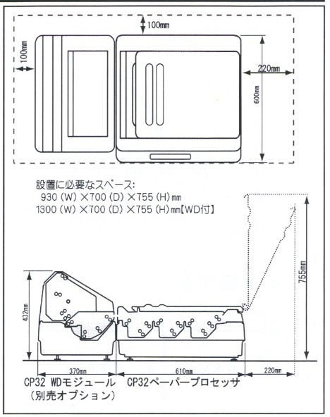

## Operating Panel {#panel data-jp="4"}

**Note:** The display shows nothing until the power cord is connected and the power switch is ON.

**Caution, dry heating:** Never turn the power switch ON while a tank is empty of water or processing solution.

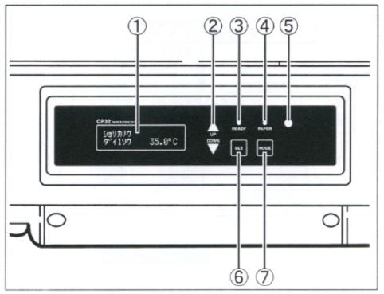

1. **Digital Display**
    Shows the settings, such as each tank’s temperature and the transport speed, and the processing status.

2. **Up/Down Switch**
    Raises (UP) or lowers (DOWN) settings such as each tank’s temperature and the transport speed.

3. **Ready Lamp**
    Shows the solution temperature. Green: tank 1 has reached the set temperature, and processing is possible. Yellow: tank 1 is more than 1 °C below or above the set temperature.

4. **Paper Detection Lamp**
    Shows the paper feed. Green: the next sheet can be inserted. Yellow: the sensor is detecting paper. Flashing yellow and green: paper can be inserted within 30 seconds, when the lamp turns green.

5. **Brightness Sensor**
    Watches the room’s brightness and dims the digital display and the lamps automatically when the room goes dark.

6. **Set Switch**
    Shows and changes settings such as each tank’s temperature and the transport speed.

7. **Mode Switch**
    Opens the screen for choosing each tank’s temperature, the transport speed, or the initial settings. The Up/Down switch then selects the item to change.

## Before Use: Operation Check and Tank Cleaning {#before-use data-jp="6–7"}

Before using the CP32, check how it works with warm water. This also cleans the tanks.

1. **Unpack the Unit**
    Take the unit and its accessories out of the packaging, and check that all the parts are there, as in [Parts](#parts).
    **Caution:** Positioning pins hold the top cover, so it cannot be lifted straight off. To remove it:

    1. Lift the right side of the top cover slightly, seen from the front (1).
    2. Push it to the left (2), and it comes off.
    3. Never remove the positioning pins.

2. **Take the Parts out of the Unit** (figures 1–3)
    In this order, remove the top cover, the inlet rack, crossover guides 1 and 2, and racks 1, 2, and 3. Raise the left side of each crossover guide, as the arrow in figure 2 shows, then lift it out.

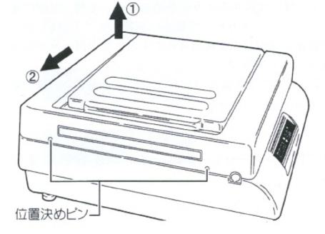

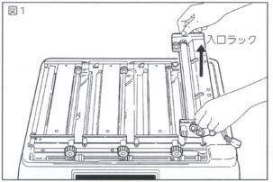

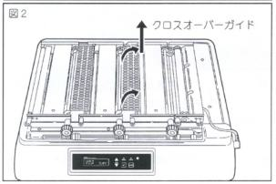

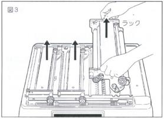

3. **Fill with Warm Water and Level the Unit** (figure 4)
    Fill each tank up to the marked line with warm water at about 20 °C. Turn the leveling screws with the supplied spanner until the unit is level.
    **Important:** The marked lines are at the back, front, and right of each tank, as in figure 4. Use them to level the whole unit carefully. If it is not level, water or processing solution can get inside the unit and cause trouble.
    **Important:** Do not use water above 50 °C. It can deform the tanks.

4. **Put the Overflow Hoses in Containers** (figure 5)
    Place containers of about 2 liters on the floor and put the overflow hoses of the unit in them. They catch the solution when it overflows. If the overflow hoses are too short, connect the supplied extension hoses. The gearbox drain empties water that gets into the gearbox when the unit is cleaned after use.

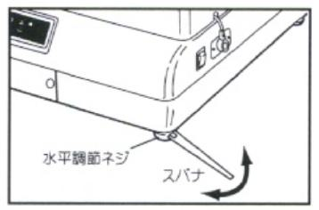

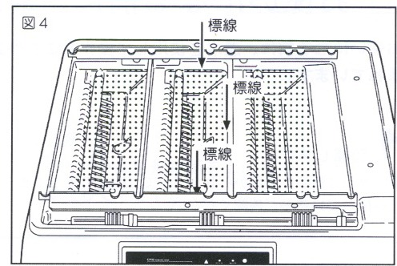

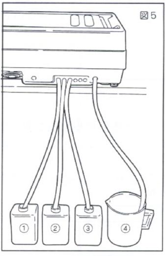

5. **Start the Unit**
    Connect the power cord to an outlet, turn the power switch ON, and check that the drive motor and the agitation pump work.
    **Caution, dry heating:** Never turn the power switch ON while a tank is empty. If the unit does run dry, turn the power off at once and wait about 10 minutes for the heater to cool before filling the tanks with water or solution.

6. **Set the Temperature and Transport Speed**
    With warm water in the tanks, go on to [Setting the Temperature and Transport Speed](#settings).

    - The drive shaft turns slowly and water jets from the agitation nozzles. This is normal.
    - **About standby:** After the power is switched on, the drive motor and the agitation pump run continuously for about 10 to 45 minutes, depending on the transport speed, and then for 3 seconds every 15 seconds. Processing cancels standby automatically, and the unit runs continuously again.

## Setting the Temperature and Transport Speed {#settings data-jp="8–9"}

The numbers in parentheses refer to the [operating panel](#panel). The display reads in katakana; the readouts below are translated.

1. **Check the Digital Display and Ready Lamp**
    With warm water in the tanks, turn the power switch ON.

    1. The display (1) shows the version of the control software for about 1 second, with the connection details of the optional WD module or replenisher if one is connected.
    2. While tank 1 is below the set temperature, 35.0 °C from the factory, the display shows PLEASE WAIT TANK 1 21.7°C and the ready lamp (3) is yellow.
    3. In about 30 minutes, tank 1 reaches the set temperature. The display shows READY TANK 1 35.0°C and the ready lamp (3) turns green.

2. **View the Temperature of Each Tank and the Transport Speed**
    Each press of the Up/Down switch (2) shows the next of tank 1’s temperature, tank 2’s, tank 3’s, and the transport speed.

3. **Set the Temperature of Each Tank and the Transport Speed**
    While the display shows a temperature or the transport speed, press the Mode switch (7). The display changes to the setting choices: SETTING TANK 1 TEMP
    Each press of the Up/Down switch (2) shows the next setting: tank 1’s temperature, tank 2’s, tank 3’s, the transport speed, and the initial settings.
    When the item you want to change is shown, press the Set switch (6) to show its value: SETTING TANK 1 &gt;35.0°C
    Press the Up/Down switch to change it, for example to 32.3 °C: SETTING TANK 1 32.3°C
    Press the Set switch to set the value, and check that “&gt;” appears to its left: SETTING TANK 1 &gt;32.3°C
    Press the Mode switch to return to the setting choices. Set each tank’s temperature and the transport speed in the same way, then press the Mode switch once more to return to the temperature and transport speed display.
    **The settings are kept when the power switch is turned off and the power cord is unplugged.**

4. **Return to the Factory Settings**
    In the setting choices, select SETTING INITIAL SETTINGS and press the Set switch. Each tank returns to 35.0 °C and the transport speed to 280 mm/min.

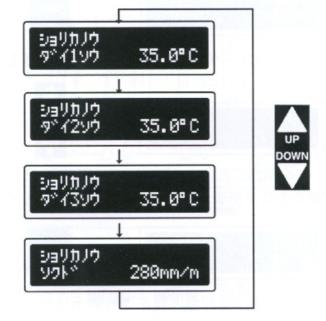

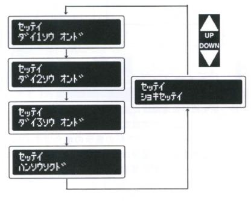

## Ready Lamp and Paper Detection Lamp {#lamps data-jp="9"}

1. **Ready Lamp**
    The ready lamp (3) shows the state of the solution temperature:

    - Green: tank 1 has reached the set temperature, and processing is possible.
    - Yellow: tank 1 is more than 1 °C below or above the set temperature.

    If the ready lamp shows either of the following, turn the power switch off at once, unplug the power cord, and contact the maker’s service department:

    - Red: there is a problem with the temperature control.
    - Flashing red: there is a problem with the internal circuits.

2. **Paper Detection Lamp**
    The paper detection lamp (4) shows the state of the paper transport:

    - Green: the next sheet can be inserted.
    - Yellow: the paper sensor is detecting paper.
    - Flashing yellow and green: paper can be inserted within 30 seconds, when the lamp turns green.

    If the paper detection lamp shows either of the following, turn the power switch off at once, unplug the power cord, and contact the maker’s service department:

    - Red: there is a problem with the transport motor.
    - Off: there is a problem with the internal circuits.

**Important:** Insert paper with the emulsion side up.

## Test Run: Racks, Crossover Guides, and Top Cover {#test-run data-jp="10–11"}

[Before Use](#before-use) and [Setting the Temperature and Transport Speed](#settings) complete the setup. Before pouring in the processing solution, check the processing with water.

1. **Set the Parts in the Unit** (figures 1–3)
    After checking that the tanks contain water, set racks 1, 2, and 3, the inlet rack, and crossover guides 1 and 2 in the unit, in that order. Plug the connector of the inlet rack into the connector on the unit. A little water may overflow when the racks go in. Turn the power switch ON.

2. **Check the Paper Transport** (figure 4)
    Insert unexposed paper emulsion side up, along the guide of the inlet rack and at the center of the rollers. The paper moves slowly into the tanks and comes out of the exit: watch the transport as it goes. This also cleans the rollers.
    Run a test like this before real processing too, when the unit has not been used for a long time or when the paper comes out dirty. Do not use developed paper again for a test run.

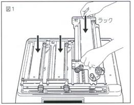

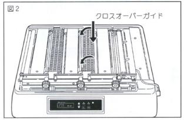

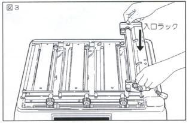

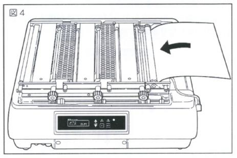

3. **Fit the Top Cover** (figures 5, 6)
    Fit the top cover on the unit, matching the two holes in its left side to the two positioning pins on the left side of the unit. Open the light-shielding cover, insert paper emulsion side up from the paper guide, and check that the paper detection lamp on the operating panel lights. The paper comes slowly out of the paper exit.
    **Note:** Real processing is done in the dark. This test run is done in room light, to check how the processing works.

4. **Drain the Water** (figure 7)
    When the checks are done, turn the power switch OFF, remove the caps of the drain hoses, and drain the water from each tank. Each drain hose is numbered for its tank.
    **Caution, dry heating:** Always turn the power switch OFF before draining. Draining with the power ON runs the heater dry and can seize the bearing of the agitation pump.

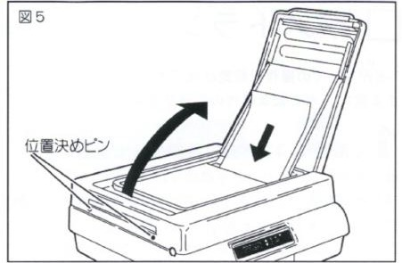

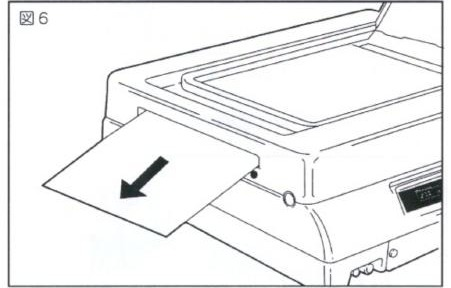

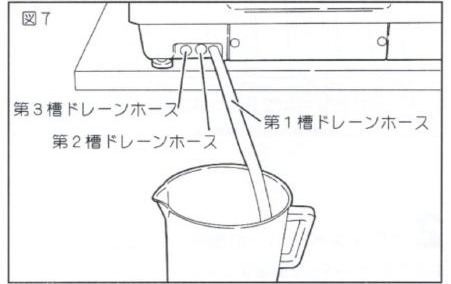

## Pouring the Processing Solution {#pouring data-jp="12–13"}

1. **Check That the Power Switch Is OFF** (figures 1–3)
    With the power switch OFF, remove the top cover, the inlet rack, the crossover guides, and the racks. If there is still water in the tanks, drain it as in step 4 of the [Test Run](#test-run).
    **Caution, dry heating:** Never run the unit with empty tanks.

2. **Prepare the Processing Solution**
    Prepare 2 liters of each solution, 1–2 °C warmer than the set temperature.

3. **Pour the Solution into Each Tank** (figure 4)
    To keep air out of the circulation pump, always put the tip of the supplied funnel into the intake at the bottom of the tank, and pour solution up to the marked line: tank 3 first, then tank 2, then tank 1. Keep the leftover solution for topping up. For the solution that goes into each tank, see [Processing Solutions](#solutions).
    **Caution:** Even a little solution from tank 2 or 3 splashing into tank 1 spoils the color. Wipe off any splashes in tank 1. Use a separate funnel for each tank, and wash it each time you pour.

4. **Turn the Power Switch ON**
    Turn the power switch ON and check that the solution jets from the agitation nozzles.

5. **Set the Racks** (figure 5)
    Turn the power switch OFF, then set racks 1–3 in the unit. Do not fit the inlet rack yet.

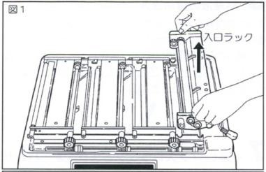

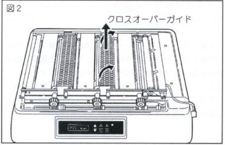

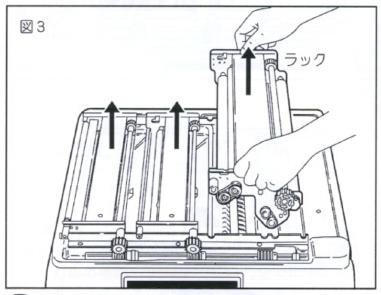

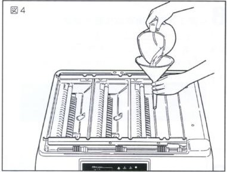

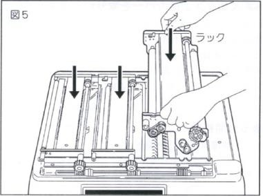

6. **Add the Remaining Solution**
    Using the funnel, pour about 100 mL more into each tank through the gaps in the racks, until it overflows. Keep what is left for topping up. The unit processes most consistently when the solution is always at the overflow.

7. **Fit the Inlet Rack and Crossover Guides** (figures 6, 7)
    Fit the inlet rack and plug its cord into the connector on the unit.
    **Caution:** Make sure the rollers of the inlet rack are dry. Moisture causes uneven development, so wipe them with a dry, soft cloth. Wipe crossover guides 1 and 2 dry too before setting them in the racks: moisture on the crossover guides also causes uneven development.

8. **Check the Driving Gears** (figure 8)
    Turn the power switch ON and check that the driving gear of each rack works. In particular, check that the groove in the shaft of each rack’s driving gear sits correctly in the positioning plate of the unit.

9. **Fit the Top Cover** (figure 9)
    Put the two holes in the left side of the top cover onto the positioning pins, then lower the cover onto the unit. A gap between the unit and the top cover lets light in, so fit it correctly.

10. **Wait 5 Minutes**
    The setup is complete. Let the unit run for about 5 minutes while the solution temperature settles, then start processing.

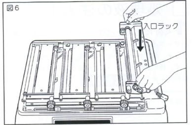

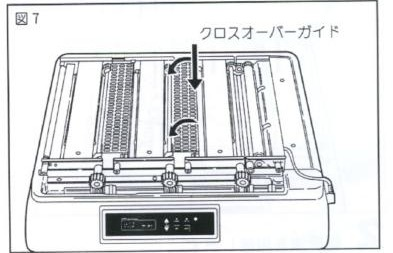

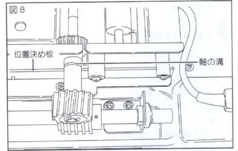

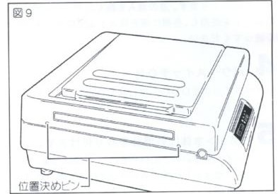

## Image Processing {#processing data-jp="14–15"}

Insert the paper in the darkroom and close the light-shielding cover, and the unit processes it automatically with the room lights on. With the power switch ON, check that:

- The solution temperature is stable (the ready lamp is green).
- The paper can be transported (the paper detection lamp is green).

1. **Insert the Paper in the Dark** (figures 1, 2)
    In the darkroom, open the light-shielding cover and slide the exposed paper down along the paper guide, emulsion side up. The CP32 processes paper from hand size (83 × 108 mm) up to small half cut, 12 × 16 inches (305 × 406 mm).
    **Important:** Insert the paper with the emulsion side up.
    **Caution:** Paper shorter than 108 mm or narrower than 40 mm cannot be processed, so do not use it; take care with small test prints in particular. Keep fingerprints off the emulsion. Insert small paper straight: along the edge of the paper guide, it goes in correctly (figure 2).

2. **Check That the Paper Detection Lamp Is Yellow** (figure 3)
    When the paper enters the inlet rack, the paper detector, an infrared photosensor, responds, and the paper detection lamp lights yellow: the paper is being transported in the inlet rack.
    **Caution** (figure 4):

    - Paper 135 mm wide or narrower may not trigger the detector if it goes in at the center of the paper guide.
    - Paper 80 mm wide or narrower may not trigger the detector if it goes in along the edge of the paper guide.

    Insert such paper so that it passes the points marked by the arrows in figure 4, and check that the lamp lights. Paper that does not pass the detector can put the unit into standby during processing. If that happens, turn the power switch OFF, and turn it ON again after 10 seconds to cancel standby.

3. **Close the Light-Shielding Cover** (figure 5)
    Check that the paper detection lamp is lit yellow, then close the light-shielding cover. Closing the cover while the sheet is still partly on the paper guide, as in figure 5, does not bend the paper.

4. **Turn on the Room Lights**
    With the light-shielding cover closed, the inside of the unit is dark, so the room lights can go on. The paper passes through each tank automatically.

5. **The Paper Detection Lamp Flashes Yellow and Green**
    The flashing means the paper is about to leave the inlet rack. Within 30 seconds the lamp turns green, and the next sheet can go in.
    **Caution:** Never open the light-shielding cover with the room lights on, even after the paper detection lamp goes out. Open it during processing only in the dark.

6. **Process the Next Sheet**
    For the next sheet, darken the room again, check that the paper detection lamp is green, and repeat steps 1–5.
    **Caution:** A sheet inserted while the lamp is yellow, or flashing yellow and green, is processed overlapping the one before. Always wait for green. Following the lamp, sheets can be processed one after another without waiting.
    **Caution:** Each four-cut sheet (10 × 12 inches) carries about 10 mL of tank 1 solution out with it. After 10 four-cut sheets in a row, top up tank 1 with the remaining developer through the funnel. The unit processes most consistently when the solution is always at the overflow.

7. **Wash and Dry Outside the Unit** (figure 6)
    The processed paper comes out of the exit. Wash it at once as the paper maker specifies. With two-bath chemistry, tank 3 only rinses the paper in standing water, so it still needs a proper wash. Dry the paper after washing. The CP32 WD module, or a Nova Washmaster or Rapid Washer, does the washing efficiently.

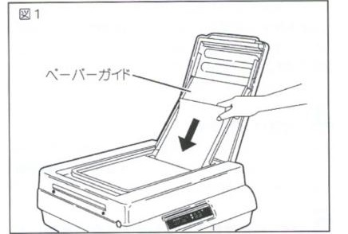

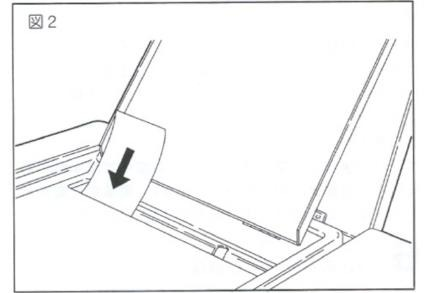

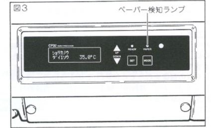

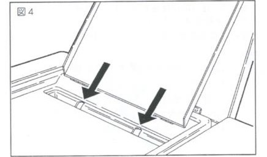

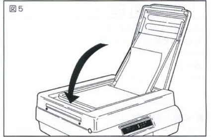

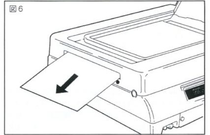

**Caution, while the CP32 waits between prints:** A fan ventilates the unit while the power is ON. To keep the humidity of the chemicals away from the mechanism, leave the light-shielding cover open as much as possible when you are not processing, and ventilate the darkroom to keep its humidity down.

**Caution:** The CP32 cannot cool the solution. Adjust the room temperature or the set temperature so that the darkroom stays at least about 5 °C cooler than the solution’s set temperature.

## Standby {#standby data-jp="15"}

- After the power is switched on, the drive motor and the agitation pump run continuously for about 10 to 45 minutes, depending on the transport speed, and then for 3 seconds every 15 seconds.
- When paper goes into the inlet rack, the paper detection lamp lights, and the unit returns to continuous running.
- Small paper must pass over the paper detector, as in steps 1 and 2 of [Image Processing](#processing). If the unit goes into standby during processing, turn the power switch OFF, and turn it ON again after 10 seconds.

## Draining the Solution {#draining data-jp="16"}

After use, drain all the solution from each tank promptly. Solution left in the tanks forms crystals on the parts and causes breakdowns.

1. **Turn the Power Switch OFF**
    Always turn the power switch OFF first. With the power ON, the agitation pump and the heater are running, and the solution cannot be drained.

2. **Drain the Solution** (figure 1)
    Pull out the three drain hoses under the unit. Catching the solution in containers of 2 liters or more, remove the drain caps and drain one tank at a time. If the hoses are too short, connect the supplied extension hoses.
    **Caution:** Solution spurts from a hose when its cap comes off; take care not to spill it.

3. **Put the Caps Back**
    Fit the drain caps, then clean the tanks, the racks, and the crossover guides thoroughly, as in [Cleaning the Parts](#cleaning).
    **Note:** Solution poured in with the drain caps off runs straight out of the drain hoses. Always put the caps back on the hoses after draining.

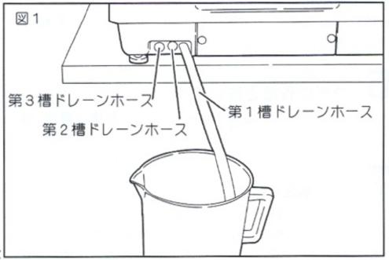

## Cleaning the Parts {#cleaning data-jp="16–17"}

Clean the tanks and the racks right after each use. Left uncleaned, crystals form on the parts and cause breakdowns.

**Caution:** Trouble caused by skipped cleaning is not covered by the warranty. To keep the unit in its best condition for a long time, clean it after every use.

1. **Turn the Power Switch OFF and Drain the Solution**
    Drain all the solution as in [Draining the Solution](#draining).
    **Caution, dry heating:** Never run the unit with empty tanks.

2. **Remove the Parts**
    Remove the top cover, crossover guides 1 and 2, the inlet rack, and racks 1–3 from the unit.

3. **Never Wash the Inlet Rack with Water** (figure 1)
    Wipe the dirty parts of the inlet rack, such as the rollers and the guide plate, lightly with a damp, soft cloth.
    **Caution:** The inlet rack has electrical parts. Never wash it with water: washing causes breakdowns. If water gets on the electrical parts, dry them completely before use.

4. **Wash the Racks** (figure 2)
    Rinse the solution off the racks and the crossover guides thoroughly under running water or a shower. Turn the rollers by hand while you wash the rollers, the gears, and the bearings.
    **Caution:** Wash each rack and crossover guide on its own, so that solution does not get onto the others.

5. **Dry the Racks and Crossover Guides**
    Let the racks dry fully with their rollers up, as in figure 2, and the crossover guides with the squeegee rubber up. Do not dry them in the unit: the humidity stays inside.

6. **Fill the Tanks**
    Fit the drain caps on the hoses and fill each tank with warm water at about 30 °C.

7. **Wash the Tanks**
    Turn the power switch ON and let the agitation wash the pump, the hoses, the nozzles, and the tanks with the warm water. After 2–3 minutes, turn the power switch OFF and drain the water through the drain hoses. Fill with warm water at about 30 °C again and repeat. Wash at least three times, then wipe the water out of the tanks.

8. **Wipe the Unit**
    Wipe the dirty parts of the unit and the top cover with a damp, soft cloth. Warm water lifts dirt better, but do not use water above 50 °C: it can deform the case. Do not use organic solvents on the resin parts of the unit, the top cover, or the mechanism.

**Caution:**

- Keep water out of the gearbox when cleaning.
- With the racks out and the power switch ON, the drive shaft turns. Keep cloths away from it.
- Clean the rollers of each rack under water with a soft cloth or gauze. Do not scrub them with a hard nylon scourer.

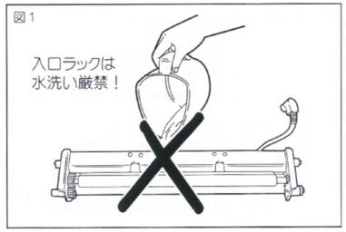

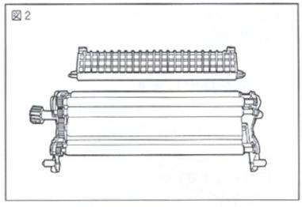

## Disposing of Waste Solution {#waste data-jp="16–17"}

Photographic chemicals contain harmful substances. Never pour them down a sink, a toilet, or any drain. Store the waste as follows, and once a certain amount has built up, ask a specialist waste disposal company to collect it.

- Store it in polytanks of 18 liters.
- Store each kind of waste separately. Do not mix developer and fixer.

The Japanese manual lists the offices of Matsuda Sangyo’s environmental division, which collect waste from individuals, from a single polytank.

## Using the CP32 Well {#care data-jp="18"}

1. **About the Crossover Guide**
    The first crossover guide has a rubber squeegee. It wipes off the solution at the trailing edge of the paper, which would otherwise drip and make the density uneven. After use, wash the solution off the squeegee with water, then store it rubber side up or fitted to its rack. Crystals or a bent blade spoil the prints.
    **Caution:** When the CP32 is used in a cool room, droplets of evaporated solution can settle on the crossover guides and the squeegee and cause uneven development. Open the top cover now and then and wipe them off.

2. **About the Replenisher Hoses**
    The unit has hoses for connecting a replenisher. With the optional replenishment unit, each tank can be topped up automatically; see its own manual. When cleaning the unit, take the caps off the hose ends and clean the solution out of the hoses too. When no replenisher is connected, keep the caps on the hose ends.

3. **Pouring the Processing Solution**
    1. Always use the supplied funnel. Stand its tip in the intake at the bottom of the tank, and pour from a measuring cup.
    2. When solution comes out of the agitation nozzle, take the funnel out of the intake, and pour the rest through the funnel up to the marked line in the tank.
    3. After setting the racks, use the funnel to add the remaining solution until it overflows.
    4. Work in the order tank 3, tank 2, tank 1.

    **Caution:** The CP32 uses a magnet pump. If air gets into the pump, it can make a metallic noise, and one tank’s agitation nozzle stops jetting. Turn the power switch OFF, drain that tank, and fill it again as above.

4. **About Ventilation**
    A fan ventilates the unit while the power is ON. To keep the humidity of the chemicals away from the mechanism, leave the light-shielding cover open as much as possible when you are not processing. Ventilate the darkroom too, to keep its humidity down.

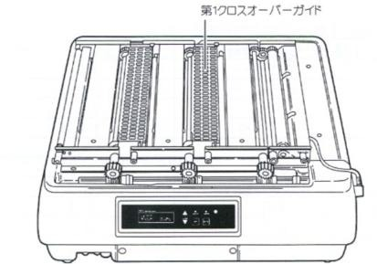

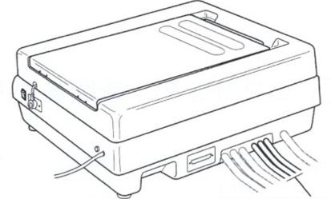

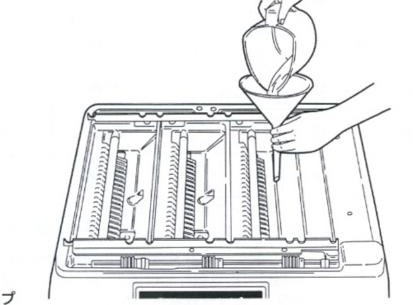

## Transport Speed and Processing Time {#speed data-jp="19"}

| Processing time per tank | Display (mm/min) |
|---|---:|
| 30 seconds | 420 |
| 45 seconds | 280 |
| 1 minute | 210 |
| 1 minute 30 seconds | 140 |
| 2 minutes | 105 |
| 3 minutes | 70 |
| 3 minutes 30 seconds | 60 |
| 4 minutes | 53 |
| 5 minutes | 42 |

The processing time runs until the paper enters the next tank.

For a processing time that is not in the table, the transport speed S, in millimeters per minute, is:

S = 12,600 ÷ a

where a is the processing time in seconds. For 2 minutes 30 seconds in tank 1, S = 12,600 ÷ 150 = 84 mm/min: set the display to 84. To set it, see [Setting the Temperature and Transport Speed](#settings).

## Sheets Processed per Hour {#capacity data-jp="19"}

Sheets per hour by paper size and transport speed, processed continuously with 50 mm between sheets. The processing time per tank is in parentheses.

| Paper size | 420 mm/min (30 s) | 280 mm/min (45 s) | 210 mm/min (1 min) | 105 mm/min (2 min) | 70 mm/min (3 min) |
|---|---:|---:|---:|---:|---:|
| Small half cut, 12 × (16) in. 305 × (406) mm | 55 | 36 | 27 | 13 | 9 |
| Large four cut, 11 × (14) in. 279 × (356) mm | 62 | 41 | 31 | 15 | 10 |
| Four cut, (10) × 12 in. (254) × 305 mm | 82 | 55 | 41 | 20 | 13 |
| Six cut, (8) × 10 in. (203) × 254 mm | 99 | 66 | 49 | 24 | 16 |
| Large cabinet, 5 × (7) in. 127 × (178) mm | 220 | 146 | 110 | 54 | 36 |

- The dimension in parentheses runs in the direction of transport.
- The large cabinet figures are for two rows of paper side by side.
- The figures are calculated, not a guarantee of how many sheets can be processed.
- Follow the chemistry maker’s figure for how many sheets 2 liters of solution can process.
- Even within that figure, change to fresh solution if the color deteriorates.

## Processing Solutions {#solutions data-jp="20"}

The CP32 can use the usual negative–positive color, positive–positive color, and monochrome solutions.

### Temperature and Transport Speed

| | Tank 1 | Tank 2 | Tank 3 |
|---|---:|---:|---:|
| Temperature | 20–40 °C | 20–40 °C | 20–40 °C |
| Transport speed | 42–420 mm/min | 42–420 mm/min | 42–420 mm/min |
| Processing time | 30 s – 5 min | 30 s – 5 min | 30 s – 5 min |

- The CP32 cannot cool the solution. Adjust the room temperature or the set temperature so that the darkroom stays at least 5 °C cooler than the solution’s set temperature.
- The transport speed, and so the processing time, is the same for all three tanks.
- The tables below give typical solutions. Other makers’ solutions can be used too, at the temperature and transport speed their maker specifies.

### Makers’ Solutions and CP32 Settings, for Reference

#### Negative–positive color, rapid processing

| Maker and product | Tank 1: color developer | Tank 2: bleach-fix | Tank 3: rinse | Speed | Time per tank |
|---|---:|---:|---:|---:|---:|
| Lucky System 700 | 35 °C | 35 °C | 25–35 °C | 280 mm/min | 45 s |
| Kodak Ektacolor RA RT (RA-4) | 35 °C | 35 °C | 25–35 °C | 280 mm/min | 45 s |
| Fuji Hobby FA | 31 °C | 31 °C | 25–35 °C | 180 mm/min | 70 s |

**Caution:** With some papers, the color balance of the dense areas can shift, and the blacks lack density. If so, process at a slower speed: instead of the standard 280 mm/min, try 190–220 mm/min.

#### Positive–positive color

| Maker and product | Tank 1: color developer | Tank 2: bleach | Tank 3: fix | Speed | Time per tank |
|---|---:|---:|---:|---:|---:|
| Ilford Ilfochrome Classic (P-30) | 29 °C | 29 °C | 29 °C | 105 mm/min | 120 s |

#### Monochrome

| Maker | Tank 1: developer | Tank 2: fix | Tank 3: rinse | Speed | Time per tank |
|---|---:|---:|---:|---:|---:|
| Any | 30 °C | 30 °C | 25–35 °C | 280 mm/min | 45 s |

**Caution:**

- Use solutions made for automatic processors or for high-temperature processing.
- Ordinary monochrome solutions meant for about 20 °C may not process consistently.
- A monochrome solution meant for about 20 °C can break down when used at 28 °C or more, and processing can fail.

**Caution:** Before changing to different solutions, clean the racks, rollers, tanks, and hoses completely. Even a little of the old solution can spoil the color.

## Troubleshooting {#troubleshooting data-jp="21" data-break="page"}

### The unit does not work when the power switch is turned on

- Is the power plug out of the outlet?
- Has the unit’s fuse blown?

### The solution is not agitated with the power switch ON

- There is air in the circulation pump. Drain the solution, then pour it in again as in step 3 of [Pouring the Processing Solution](#pouring).

### The print does not come out

- Paper shorter than 108 mm or narrower than 40 mm is not transported. Take a jammed sheet out by removing the rack. See step 1 of [Image Processing](#processing).
- Are the rack gears engaged correctly with the drive shaft? See step 8 of [Pouring the Processing Solution](#pouring).
- Are the crossover guides fitted correctly? See step 1 of the [Test Run](#test-run) and step 7 of [Pouring the Processing Solution](#pouring).
- Is the unit in standby? Cancel it as in step 2 of [Image Processing](#processing).

### The blacks lack density

- The developer has passed its capacity. Replace it.
- Did a knock to the unit splash bleach-fix into the developer?

### The print is too light

- For negative–positive prints, is the developer too cool?
- Is the developer exhausted?

### The print is too dark

- For positive–positive prints, is the developer too cool?
- Is the developer exhausted?

### Scratches on the paper, parallel to the transport

- Are the crossover guides fitted correctly? See figure 7 of [Pouring the Processing Solution](#pouring).

### Clear streaks at right angles to the transport

- With small paper, was standby canceled? Cancel it as in step 2 of [Image Processing](#processing).
- Was the power switch turned off for a moment during processing?

### Cloudy, irregular unevenness

- The rollers of the inlet rack are wet. See step 7 of [Pouring the Processing Solution](#pouring).

### The paper comes out dirty

- The transport rollers are dirty. Clean them as in steps 4 and 5 of [Cleaning the Parts](#cleaning).
- The first prints pick up dirt easily. Run one or two waste sheets before real processing, as in step 2 of the [Test Run](#test-run).

### The paper is fogged by light

- Was the light-shielding cover opened during processing? See step 5 of [Image Processing](#processing).
- Is the top cover fitted correctly, with its holes on the positioning pins of the unit? See step 9 of [Pouring the Processing Solution](#pouring).
- Fog from the lamps on the operating panel: handle the paper carefully, insert it into the inlet rack as quickly as possible, and close the light-shielding cover.

### The solution stays above the set temperature

- The unit cannot cool the solution. Cool the darkroom with air conditioning to about 5 °C below the solution’s set temperature.

